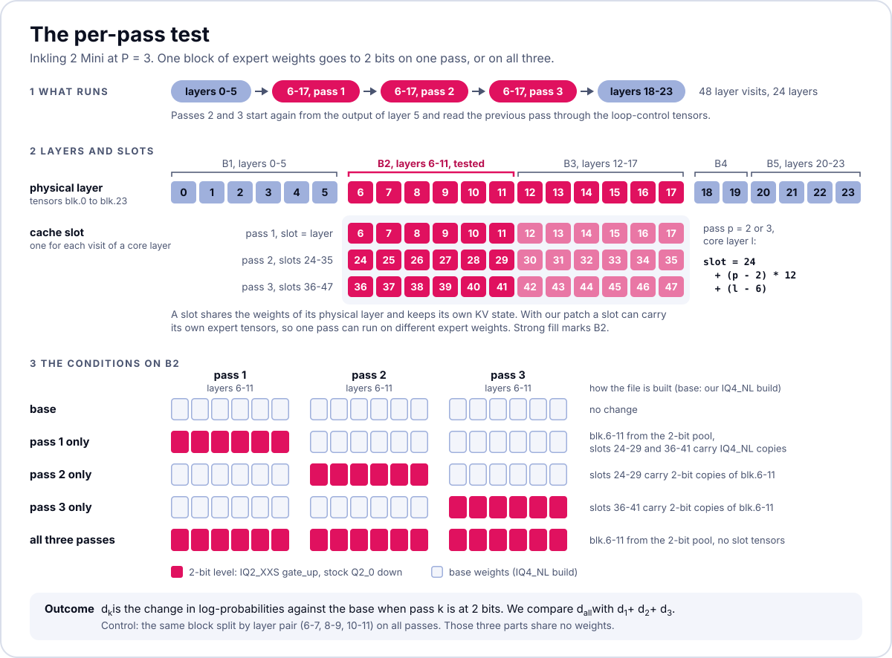

# Counting passes


Inkling 2 Mini is a mixture-of-experts model with a loop. Layers 6 to 17 run three times on the same expert weights. In this exploratory pilot, we measured what that loop does to quantization error. The repository holds the llama.cpp patches, run scripts, analysis code and result files. The GGUF is hosted separately on Hugging Face.

- Full write-up: [docs/report.md](docs/report.md)
- Model on Hugging Face: [Me-Daniel/Inkling-2-Mini-Metal-GGUF](https://huggingface.co/Me-Daniel/Inkling-2-Mini-Metal-GGUF)

## Results

Every number comes from `results/pilot/`. KL is measured against a Q8_0 reference at P = 3 passes. T1 and T2 are held-out sets.

### 1. Behind Unsloth on quality, ahead on a Mac with stock llama.cpp

- Pre-registered gate: FAIL. The candidate (11,514,054,944 bytes) has higher KL than Unsloth UD-IQ3_XXS (11,663,310,784 bytes) on both held-out sets. The difference is +0.00747 [+0.00654, +0.00845] on T1 and +0.00581 [+0.00513, +0.00673] on T2. The FAIL stands.
- The candidate passes a narrower, post hoc comparison that we registered after the FAIL. We scored 3 comparison files under the size limit that keep all expert tensors in Metal-supported types (bartowski IQ2_S, AtomicChat AD-IQ2_S, mudler APEX-I-Nano). The candidate has lower KL than each on T1 and T2, with the 95% CI for each difference below zero. We registered two more files under the limit (IsValorum APEX-I-NanoPlus-V2.1, prithivMLmods Q2_K) but have yet to score them.
- With stock llama.cpp, UD-IQ3_XXS is slower on our Mac. It keeps 20 expert tensors in NVFP4, which stock llama.cpp's Metal backend cannot multiply yet. On an Apple M5 Pro with llama-bench (llama.cpp `29b52d3` plus our patches), UD-IQ3_XXS generated at 10.87 t/s and the candidate at 18.97 t/s. The candidate was 1.75 times as fast. The all-Metal files we tested at this size ran at about the same speed. Builds that run NVFP4 on Metal don't have the CPU fallback, so the gap applies to stock llama.cpp.


With 16K tokens already in context, the speed gap to UD-IQ3_XXS narrows to 2.1× on prompts and 1.46× on generation (`results/pilot/depth-*.txt`).

### 2. Single-pass changes do not add up to the all-pass change (2-bit block, layers 6-11)

- The test: we put a 2-bit block (layers 6-11) on pass 1 only, pass 2 only, pass 3 only and on all three. Then we compared the all-pass logit change with the sum of the three single-pass changes. The residual share r is 0.675 [0.657, 0.693], where 0 would mean the parts add up exactly.
- The control: splitting the same block by layer pair, where the parts share no weights, gives r = 0.838 [0.822, 0.855]. By both r and the norm ratio, the pass split is closer to additive than the layer split. The intervals for the two splits do not overlap on either measure.
- What it does not show: the additivity measures disagree. KL all / sum is 1.135, above 1, and the Fisher norm ratio is 0.841, below 1. We do not classify the error. The result covers one block at one amplitude on 16 chunks of text.


How the test is built:



## Run the model

The model needs a llama.cpp build with Inkling 2 support (upstream after 20 Nov 2026). Homebrew's llama.cpp releases as of that date could not load it.

```sh
llama-cli -m Inkling-2-Mini-Metal.gguf -ngl 99 --jinja -c 32768 --temp 1.0 --reasoning-budget 16384
llama-server -m Inkling-2-Mini-Metal.gguf -ngl 99 --jinja -c 32768 --temp 1.0 --reasoning-budget 16384 --port 8080
```

The release sets the temperature to 1.0 in `generation_config.json`. The base model card warns about long reasoning loops, so the commands cap thinking at 16K tokens. The loop count stays at its default of 3.

Stock upstream llama.cpp (`c661033`, no patches) gives this file the same scores as the build used for the tables (T1: KL 0.026856, top-1 93.139%).

### Which Mac

- 24 GB or more: the model fits with room for a 16K context and other apps.
- 16 GB: the model can run after you raise the GPU memory limit, with a short context and little RAM left for other apps. By default, macOS lets the GPU use only about two thirds of RAM, which is less than the model needs. To raise the limit:

```sh
sudo sysctl iogpu.wired_limit_mb=13000   # resets on reboot
```

On our Mac, memory use for the whole process peaked at 13.9 GB with the context filled to 16K tokens (`results/pilot/memory-cand.txt`).

## Reproduce

Everything ran on one Apple M5 Pro with 48 GB, one heavy process at a time. Model files, data and logs are not in git. The scripts rebuild them and resume where they stopped.

```sh
sh scripts/build-llama.sh                     # llama.cpp 29b52d3 (b12600) plus patches/llama.cpp, Release with Metal
.venv/bin/python -I scripts/prepare-data.py   # S, T1 and the T2 prompts, with hashes
sh scripts/g0.sh                              # BF16 conversion, Q8_0 reference, IQ4_NL build, 2-bit and 3-bit pools
sh scripts/map.sh                             # block map and pass sweep
sh scripts/phase2b.sh                         # map entry with non-expert tensors at Q6_K
sh scripts/perpass.sh                         # per-pass test and noise conditions
sh scripts/map2.sh                            # map levels with a 2-bit gate_up only
sh scripts/q2opt-all.sh                       # our weighted Q2_0 encoding of every layer
sh scripts/map3.sh                            # map level with the weighted Q2_0 down projection
sh scripts/perpass2.sh                        # per-pass controls
sh scripts/phase4.sh                          # T2 traces, allocation, candidate, gate
sh scripts/fetch-ext.sh                       # outside files for the Mac comparison
sh scripts/macgate.sh                         # Mac comparison, stability, bench
.venv/bin/python -I scripts/figures.py        # figures from results/pilot/
```

We ran the steps in the order shown. The chain scripts `scripts/pilot-chain.sh` to `scripts/pilot-chain6.sh` ran them back to back. Each one waits for the step before it and expects the earlier chain's output in `logs/`.

Checks:

```sh
.venv/bin/python -I -m pytest -q tests                                  # analysis tests on synthetic data
vendor/llama.cpp/build/bin/test-llama-archs --loop-scales -s 42         # passes share the expert scales
vendor/llama.cpp/build/bin/test-llama-archs --loop-slots -s 42          # a slot uses its own experts
vendor/llama.cpp/build/bin/test-llama-archs -a 'inkling2.*'             # upstream consistency tests
```

We created the Python environment with `uv venv .venv` and installed the packages in llama.cpp's `requirements-convert_hf_to_gguf.txt`, plus gguf-py, pyarrow, tokenizers, matplotlib and pytest. The engine is pinned to llama.cpp `29b52d398b294509746ec0a3f28948a3107c0213` plus 7 patches. `results/env.md` lists the patch hashes and the build.

## Repository layout

| Path | What it holds |
|---|---|
| `docs/report.md` | The pilot report |
| `figures/` | Figures as PNG and SVG, written by `scripts/figures.py`, plus the two diagrams |
| `results/` | Build environment, data hashes and the pilot's result files in `results/pilot/` |
| `analysis/` | Per-pass residual, allocator, paired bootstrap, report writers and the figure style |
| `scripts/` | Build, data, splicing, run chains, reports and figures |
| `patches/llama.cpp/` | 7 patches on llama.cpp `29b52d3`, three of them tests |
| `tests/` | Tests for the analysis code |

The scripts create `models/`, `data/`, `logs/` and `vendor/`. These directories stay out of git.

## Status

We ran this exploratory pilot on 21 November 2026 for a master's thesis, "Counting Passes". None of the results are confirmatory evidence. We used one reference, one importance matrix, one machine and one engine commit. KL measures divergence from the reference and does not measure task quality.

We recorded the hypotheses, data splits and gates before collecting the data each one governs. The pre-registration and a dated addendum for every later change appear in [CHANGELOG.md](CHANGELOG.md).
