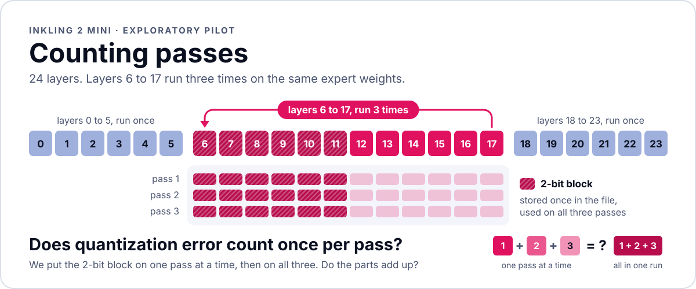
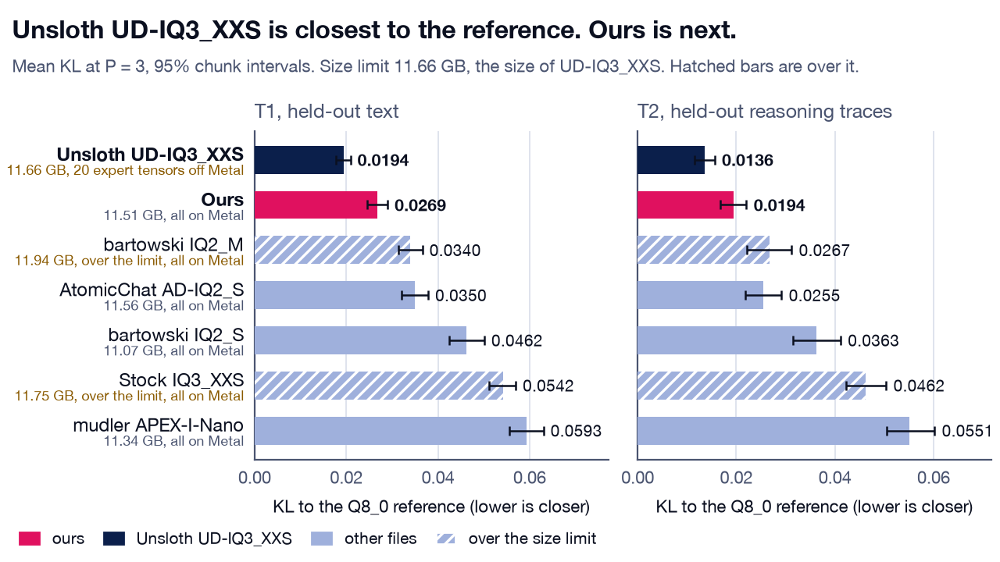
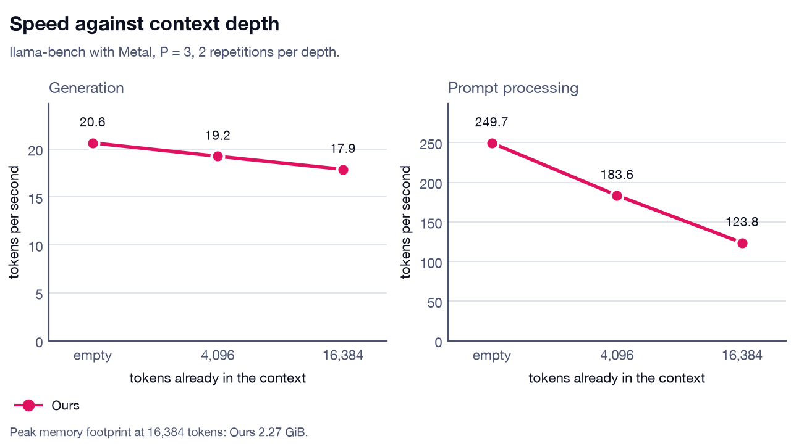
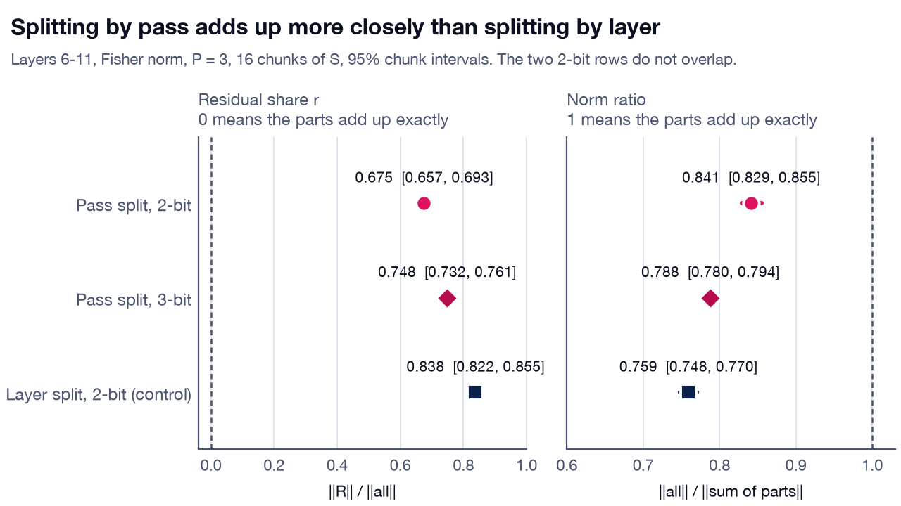

# Counting passes



Inkling 2 Mini is a mixture-of-experts model with a loop. Layers 6 to 17 run three times on the same expert weights. This repository measures what that loop does to quantization error. It holds the llama.cpp patches, the run scripts, the analysis code and the result files of an exploratory pilot. The GGUF that came out of the pilot is not in this repository. It is linked below.

- Full write-up: [docs/report.md](docs/report.md)
- Model on Hugging Face: [Me-Daniel/Inkling-2-Mini-Metal-GGUF](https://huggingface.co/Me-Daniel/Inkling-2-Mini-Metal-GGUF)

## Results

Every number comes from `results/pilot/`. KL is measured against a Q8_0 reference at P = 3 passes. T1 and T2 are held-out sets.

### 1. The release gate failed, and a narrower comparison passed

- The pre-registered gate is a FAIL: our file (11,514,054,944 bytes) has higher KL than Unsloth UD-IQ3_XXS (11,663,310,784 bytes) on both held-out sets. The difference is +0.00747 [+0.00654, +0.00845] on T1 and +0.00581 [+0.00513, +0.00673] on T2. The FAIL stands.
- A narrower comparison passes (registered after the FAIL, so post hoc): among the 3 scored files under the size limit that keep all expert tensors in Metal-supported types (bartowski IQ2_S, AtomicChat AD-IQ2_S, mudler APEX-I-Nano), ours has lower KL on T1 and T2, with the 95% CI below zero. Two more files under the limit (IsValorum APEX-I-NanoPlus-V2.1, prithivMLmods Q2_K) are registered and not scored yet.
- On a Mac, UD-IQ3_XXS is slower: it keeps 20 expert tensors in NVFP4, which the pinned Metal backend cannot multiply. On an Apple M5 Pro with llama-bench (llama.cpp `29b52d3` plus our patches) it generates at 10.87 t/s and ours at 18.97 t/s, which is 1.75 times as fast. All-Metal files of this size run at about the same speed as each other.





With 16K tokens already in context the speed gap to UD-IQ3_XXS narrows to 2.1× on prompts and 1.46× on generation (`results/pilot/depth-*.txt`).

### 2. Single-pass changes do not add up to the all-pass change (2-bit block, layers 6-11)

- The test: we put a 2-bit block (layers 6-11) on pass 1 only, pass 2 only, pass 3 only and on all three. Then we compared the all-pass logit change with the sum of the three single-pass changes. The residual share r is 0.675 [0.657, 0.693], where 0 would mean the parts add up exactly.
- The control: splitting the same block by layer pair, where the parts share no weights, gives r = 0.838 [0.822, 0.855]. On r and on the norm ratio the pass split is closer to additive than the layer split, and the intervals do not overlap.
- What it does not show: the additivity comparators disagree. KL all / sum is 1.135, above 1, and the Fisher norm ratio is 0.841, below 1. We do not classify the error. The result covers one block at one amplitude on 16 chunks of text.



How the test is built:


## Run the model

Needs a llama.cpp build with Inkling 2 support (upstream after 20 Nov 2026). Homebrew's llama.cpp releases of that date do not load it yet.

```sh
llama-cli -m Inkling-2-Mini-Metal.gguf -ngl 99 --jinja -c 32768 --temp 1.0 --reasoning-budget 16384
llama-server -m Inkling-2-Mini-Metal.gguf -ngl 99 --jinja -c 32768 --temp 1.0 --reasoning-budget 16384 --port 8080
```

Temperature 1.0 is the release's `generation_config.json` value. The base model card warns about long reasoning loops, so the commands cap thinking at 16K tokens. The loop count stays at its default of 3.

Stock upstream llama.cpp (`c661033`, no patches) scores this file identically to the build used for the tables (T1: KL 0.026856, top-1 93.139%).

### Which Mac

- 24 GB or more: fits comfortably, with room for a 16K context and other apps.
- 16 GB: possible after raising the GPU memory limit, with a short context and little RAM left for other apps. macOS lets the GPU use only about two thirds of RAM by default, which is less than the model needs:

```sh
sudo sysctl iogpu.wired_limit_mb=13000   # resets on reboot
```

Measured on our Mac, the whole process peaked at 13.9 GB with the context filled to 16K tokens (`results/pilot/memory-cand.txt`).

## Reproduce

Everything ran on one Apple M5 Pro with 48 GB, one heavy process at a time. Model files, data and logs are not in git. The scripts rebuild them and resume where they stopped.

```sh
sh scripts/build-llama.sh                     # llama.cpp 29b52d3 (b12600) plus patches/llama.cpp, Release with Metal
.venv/bin/python -I scripts/prepare-data.py   # S, T1 and the T2 prompts, with hashes
sh scripts/g0.sh                              # BF16 conversion, Q8_0 reference, IQ4_NL build, 2-bit and 3-bit pools
sh scripts/map.sh                             # block map and pass sweep
sh scripts/phase2b.sh                         # map entry with non-expert tensors at Q6_K
sh scripts/perpass.sh                         # per-pass test and noise conditions
sh scripts/map2.sh                            # map levels with a 2-bit gate_up only
sh scripts/q2opt-all.sh                       # our weighted Q2_0 encoding of every layer
sh scripts/map3.sh                            # map level with the weighted Q2_0 down projection
sh scripts/perpass2.sh                        # per-pass controls
sh scripts/phase4.sh                          # T2 traces, allocation, candidate, gate
sh scripts/fetch-ext.sh                       # outside files for the Mac comparison
sh scripts/macgate.sh                         # Mac comparison, stability, bench
.venv/bin/python -I scripts/figures.py        # figures from results/pilot/
```

That is the order the pilot ran them in. The chain scripts `scripts/pilot-chain.sh` to `scripts/pilot-chain6.sh` ran these steps back to back. Each one waits for the step before it and expects the earlier chain's output in `logs/`.

Checks:

```sh
.venv/bin/python -I -m pytest -q tests                                  # analysis tests on synthetic data
vendor/llama.cpp/build/bin/test-llama-archs --loop-scales -s 42         # passes share the expert scales
vendor/llama.cpp/build/bin/test-llama-archs --loop-slots -s 42          # a slot uses its own experts
vendor/llama.cpp/build/bin/test-llama-archs -a 'inkling2.*'             # upstream consistency tests
```

The Python environment is a `uv venv .venv` with llama.cpp's `requirements-convert_hf_to_gguf.txt`, gguf-py, pyarrow, tokenizers, matplotlib and pytest. The engine is pinned to llama.cpp `29b52d398b294509746ec0a3f28948a3107c0213` plus 7 patches. `results/env.md` lists the patch hashes and the build.

## Repository layout

| Path | What it holds |
|---|---|
| `docs/report.md` | The pilot report |
| `figures/` | Figures as PNG and SVG, written by `scripts/figures.py`, plus the two diagrams |
| `results/` | Build environment, data hashes and the pilot's result files in `results/pilot/` |
| `analysis/` | Per-pass residual, allocator, paired bootstrap, report writers and the figure style |
| `scripts/` | Build, data, splicing, run chains, reports and figures |
| `patches/llama.cpp/` | 7 patches on llama.cpp `29b52d3`, three of them tests |
| `tests/` | Tests for the analysis code |

`models/`, `data/`, `logs/` and `vendor/` are created by the scripts and stay out of git.

## Status

This is an exploratory pilot for a master's thesis, "Counting Passes", run on 21 November 2026. None of it is confirmatory evidence. It uses one reference, one importance matrix, one machine and one engine commit, and KL to a reference is not task quality.

The hypotheses, data splits and gates were written down before the data they govern. That pre-registration lives in [CHANGELOG.md](CHANGELOG.md), with every later change as a dated addendum.
