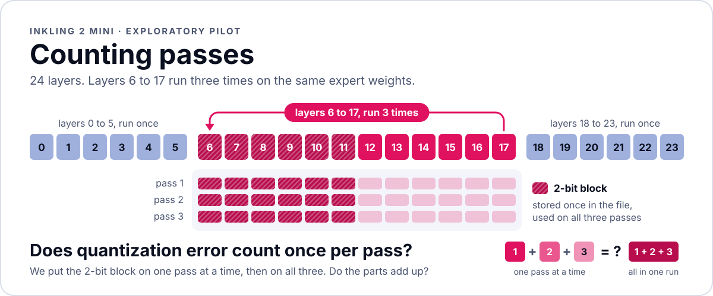
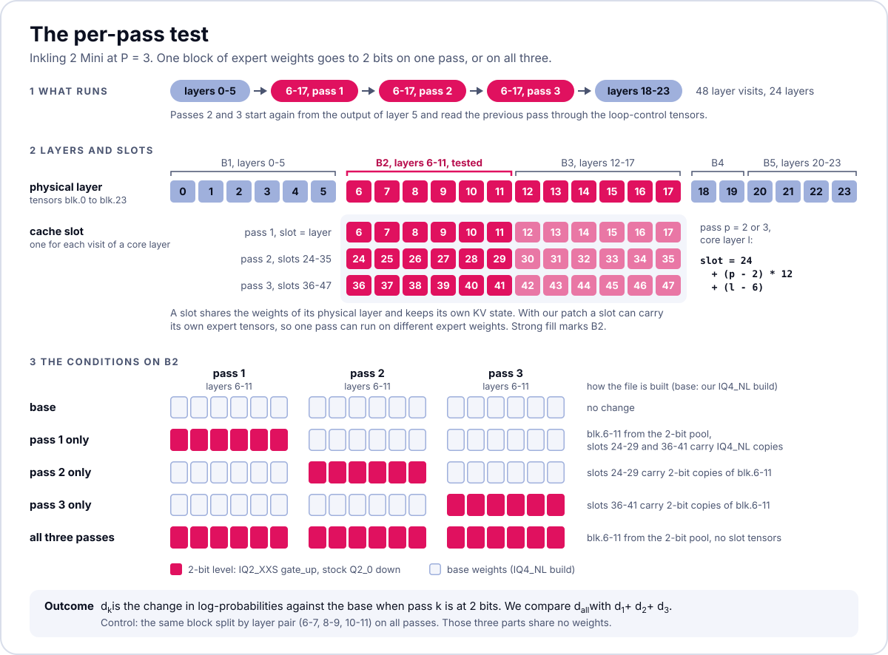
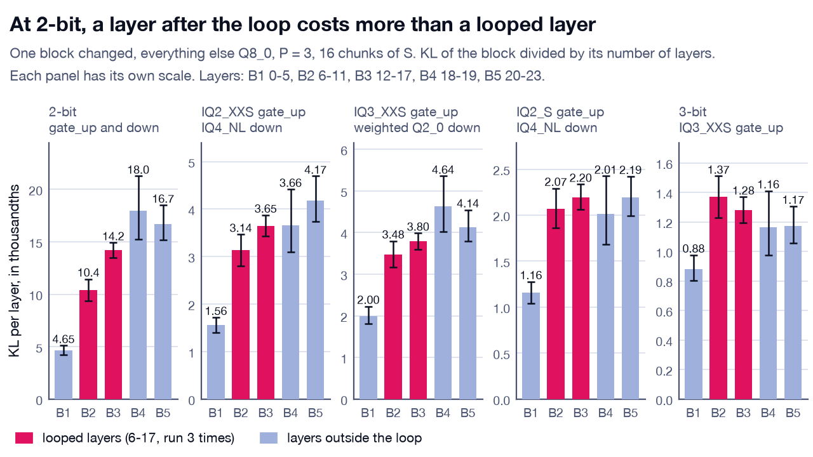
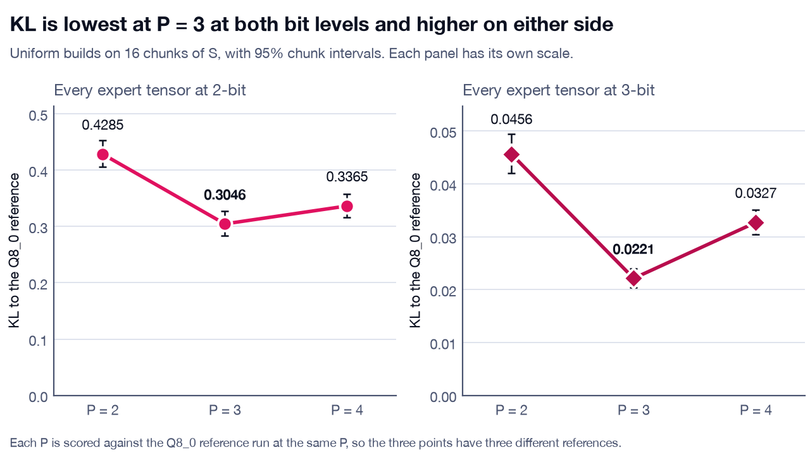
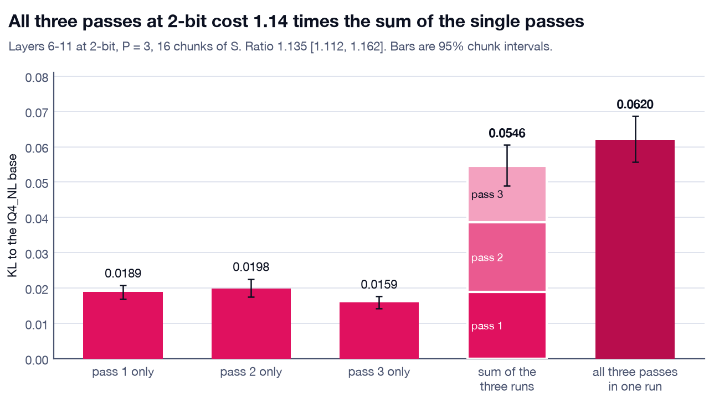
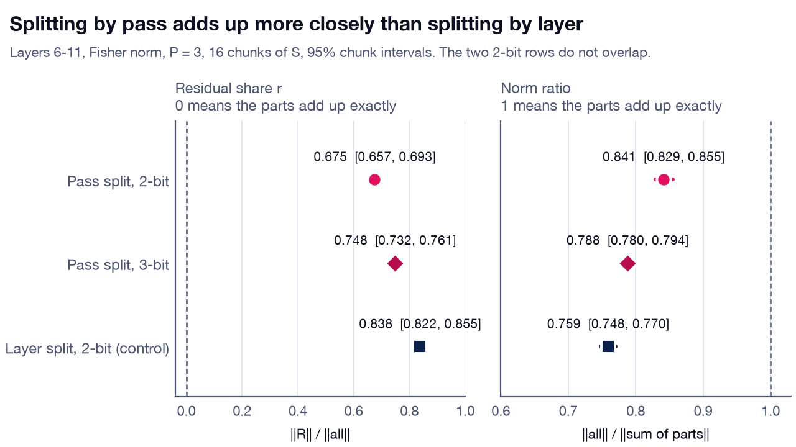
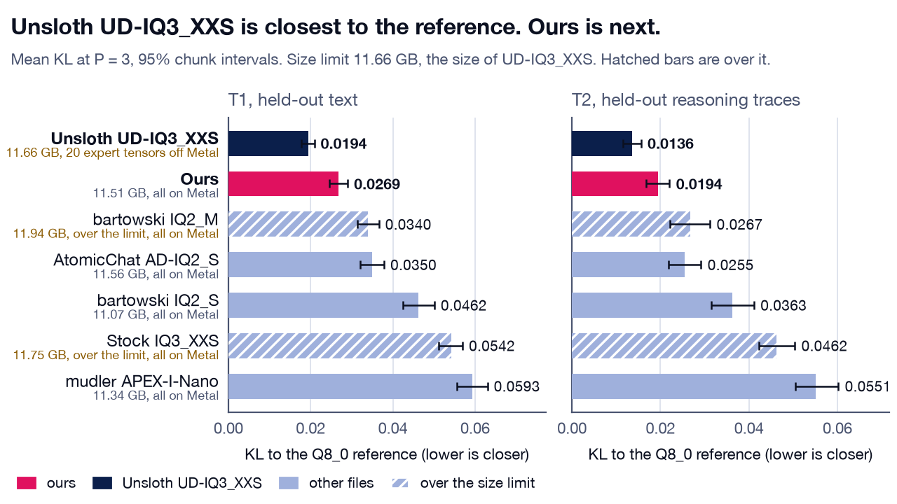
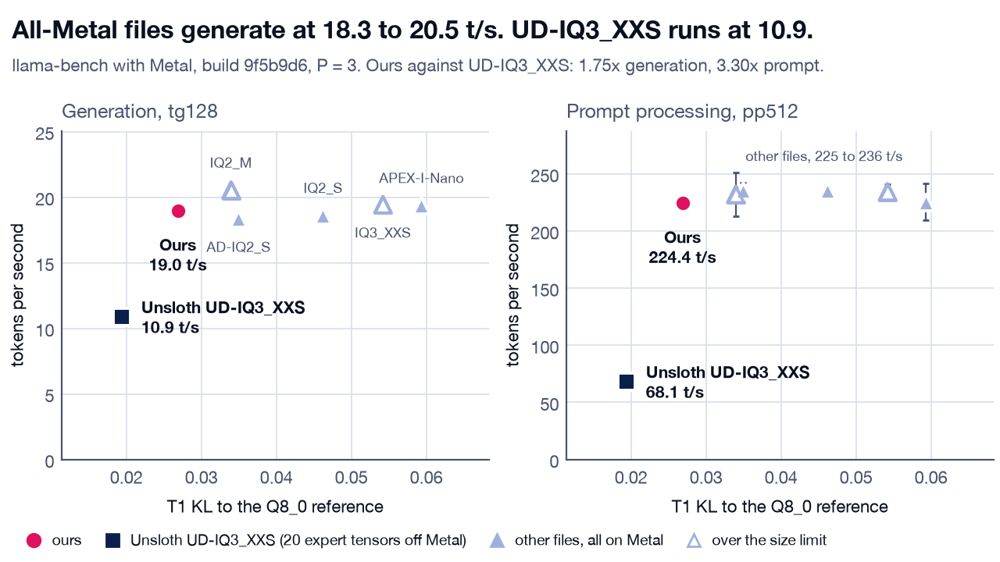

# Unslop: GitHub README and pilot report

- Date: 2026-11-21
- Model: GPT-6.2 Astra, effort medium (`.claude/skills/crosscheck/codex-ask.sh`, Codex CLI, isolated, read-only)
- Input: README.md and docs/report.md only. The report went in 3 parts split at section boundaries (lines 1-83, 84-246, 247-379), one call each, so 4 calls in all.
- Check: a script compared the original and the edited file for the multiset of numbers, the set of links, the set of image paths, code blocks, heading levels and every table row, and scanned for dashes, curly quotes, bold lead-in bullets and the banned words. Both installed files pass every check.
- Applied: Astra's wording throughout, with the fixes listed at the end.

## Prompt

Each call sent the text below, then (for the report) the line "This is part N of 3 of docs/report.md (split at section boundaries; edit only this part).", then "--- FILE ---" and the file or part verbatim.

````text
You are editing a Markdown file from a research repository (a master's thesis pilot on quantizing a looped mixture-of-experts model) so it reads like a careful human wrote it, not an AI. This is a light wording pass. Most of the text is already plain. Change only what needs changing, and leave good sentences alone.

Unslop rules:
- Remove AI patterns: significance inflation, promotional words, superficial -ing phrases, vague attributions, AI vocabulary (additionally, crucial, delve, enhance, showcase, underscore, pivotal, landscape, testament, intricate, interplay...), "serves as / stands as / features / boasts", negative parallelisms ("not just X, it's Y"), forced groups of three, synonym cycling (pick one term and repeat it), false ranges, filler ("in order to", "it is important to note"), excessive hedging, generic conclusions, chatbot phrases.
- Voice: vary sentence rhythm, be specific, first person plural "we" is fine, plain and direct. Short is better.
- Keep useful structure. Lists, numbered steps and tables stay lists, numbered steps and tables. Do not flatten them into prose.

Prose rules:
- No em dashes or en dashes anywhere.
- No colon joining two clauses of a sentence. A colon before a list, table, figure or code block is fine, and so is a short opener in a list item ("- Opener: text").
- Never start a bullet with a bold mini-sentence ("- **The gate failed.** Text"). Rewrite such a bullet as "- Plain opener: text" or as a plain sentence. Do not bold names in list items either.
- Bold paragraph labels at the start of a paragraph that is not a list item (such as "**Speed.**" or "**Verdict: FAIL.**") may stay.
- Sentence-case headings, straight quotes, no emojis.

Hard constraints:
- Keep every number exactly as written, the same number of times (including byte counts, intervals, version hashes, dates, times, ratios and counts). Do not round, convert, spell out, merge or drop any number.
- Keep every link, URL, image (alt text may be lightly edited, the path must not change), table (every table row byte for byte), code block, inline code span and heading level unchanged. Heading text may only change if it violates sentence case.
- Do not add facts, claims, explanations or caveats that are not in the text. Do not remove a caveat or a limit.
- Keep the FAIL of the release gate against Unsloth UD-IQ3_XXS first among the results where it appears now, with both margins (T1 and T2) and their intervals.
- Keep every claim exactly as scoped as the original (post hoc, exploratory, one machine, one engine commit, the files tested on that date).
- Never use the words best, fastest, first, beats, same size, loop-aware.
- Keep technical terms consistent: candidate, cand, KL, pass, P, block, gate_up, down, S, T1, T2, UD-IQ3_XXS.

Return only the full rewritten Markdown text of the part below, nothing else: no preamble, no code fence around the whole reply, no notes.
````

## Reply: README.md (verbatim)

````markdown
# Counting passes


Inkling 2 Mini is a mixture-of-experts model with a loop. Layers 6 to 17 run three times on the same expert weights. In this exploratory pilot, we measured what that loop does to quantization error. The repository holds the llama.cpp patches, run scripts, analysis code and result files. The GGUF is hosted separately on Hugging Face.

- Full write-up: [docs/report.md](docs/report.md)
- Model on Hugging Face: [Me-Daniel/Inkling-2-Mini-Metal-GGUF](https://huggingface.co/Me-Daniel/Inkling-2-Mini-Metal-GGUF)

## Results

Every number comes from `results/pilot/`. KL is measured against a Q8_0 reference at P = 3 passes. T1 and T2 are held-out sets.

### 1. The release gate failed, and a narrower comparison passed

- Pre-registered gate: FAIL. The candidate (11,514,054,944 bytes) has higher KL than Unsloth UD-IQ3_XXS (11,663,310,784 bytes) on both held-out sets. The difference is +0.00747 [+0.00654, +0.00845] on T1 and +0.00581 [+0.00513, +0.00673] on T2.
- The candidate passes a narrower, post hoc comparison that we registered after the FAIL. We scored 3 comparison files under the size limit that keep all expert tensors in Metal-supported types (bartowski IQ2_S, AtomicChat AD-IQ2_S, mudler APEX-I-Nano). The candidate has lower KL than each on T1 and T2, with the 95% CI for each difference below zero. We registered two more files under the limit (IsValorum APEX-I-NanoPlus-V2.1, prithivMLmods Q2_K) but have yet to score them.
- UD-IQ3_XXS is slower on our Mac. It keeps 20 expert tensors in NVFP4, which the pinned Metal backend cannot multiply. On an Apple M5 Pro with llama-bench (llama.cpp `29b52d3` plus our patches), UD-IQ3_XXS generated at 10.87 t/s and the candidate at 18.97 t/s. The candidate was 1.75 times as fast. The all-Metal files we tested at this size ran at about the same speed.


With 16K tokens already in context, the speed gap to UD-IQ3_XXS narrows to 2.1× on prompts and 1.46× on generation (`results/pilot/depth-*.txt`).

### 2. Single-pass changes do not add up to the all-pass change (2-bit block, layers 6-11)

- The test: we put a 2-bit block (layers 6-11) on pass 1 only, pass 2 only, pass 3 only and on all three. Then we compared the all-pass logit change with the sum of the three single-pass changes. The residual share r is 0.675 [0.657, 0.693], where 0 would mean the parts add up exactly.
- The control: splitting the same block by layer pair, where the parts share no weights, gives r = 0.838 [0.822, 0.855]. By both r and the norm ratio, the pass split is closer to additive than the layer split. The intervals for the two splits do not overlap on either measure.
- The measures disagree on additivity. KL all / sum is 1.135, above 1, and the Fisher norm ratio is 0.841, below 1. We do not classify the error. The result covers one block at one amplitude on 16 chunks of text.


How the test is built:


## Run the model

The model needs a llama.cpp build with Inkling 2 support (upstream after 20 Nov 2026). Homebrew's llama.cpp releases as of that date could not load it.

```sh
llama-cli -m Inkling-2-Mini-Metal.gguf -ngl 99 --jinja -c 32768 --temp 1.0 --reasoning-budget 16384
llama-server -m Inkling-2-Mini-Metal.gguf -ngl 99 --jinja -c 32768 --temp 1.0 --reasoning-budget 16384 --port 8080
```

The release sets the temperature to 1.0 in `generation_config.json`. The base model card warns about long reasoning loops, so the commands cap thinking at 16K tokens. The loop count stays at its default of 3.

Stock upstream llama.cpp (`c661033`, no patches) gives the candidate the same scores as the build used for the tables (T1: KL 0.026856, top-1 93.139%).

### Which Mac

- 24 GB or more: the model fits with room for a 16K context and other apps.
- 16 GB: the model can run after you raise the GPU memory limit, with a short context and little RAM left for other apps. By default, macOS lets the GPU use only about two thirds of RAM, less than the model needs. We raised the limit with this command:

```sh
sudo sysctl iogpu.wired_limit_mb=13000   # resets on reboot
```

On our Mac, memory use for the whole process peaked at 13.9 GB with the context filled to 16K tokens (`results/pilot/memory-cand.txt`).

## Reproduce

Everything ran on one Apple M5 Pro with 48 GB, one heavy process at a time. Model files, data and logs are not in git. The scripts rebuild them and resume where they stopped.

```sh
sh scripts/build-llama.sh                     # llama.cpp 29b52d3 (b12600) plus patches/llama.cpp, Release with Metal
.venv/bin/python -I scripts/prepare-data.py   # S, T1 and the T2 prompts, with hashes
sh scripts/g0.sh                              # BF16 conversion, Q8_0 reference, IQ4_NL build, 2-bit and 3-bit pools
sh scripts/map.sh                             # block map and pass sweep
sh scripts/phase2b.sh                         # map entry with non-expert tensors at Q6_K
sh scripts/perpass.sh                         # per-pass test and noise conditions
sh scripts/map2.sh                            # map levels with a 2-bit gate_up only
sh scripts/q2opt-all.sh                       # our weighted Q2_0 encoding of every layer
sh scripts/map3.sh                            # map level with the weighted Q2_0 down projection
sh scripts/perpass2.sh                        # per-pass controls
sh scripts/phase4.sh                             # T2 traces, allocation, candidate, gate
sh scripts/fetch-ext.sh                       # outside files for the Mac comparison
sh scripts/macgate.sh                         # Mac comparison, stability, bench
.venv/bin/python -I scripts/figures.py        # figures from results/pilot/
```

We ran the steps in the order shown. The chain scripts `scripts/pilot-chain.sh` to `scripts/pilot-chain6.sh` ran them back to back. Each one waits for the step before it and expects the earlier chain's output in `logs/`.

Checks:

```sh
.venv/bin/python -I -m pytest -q tests                                  # analysis tests on synthetic data
vendor/llama.cpp/build/bin/test-llama-archs --loop-scales -s 42         # passes share the expert scales
vendor/llama.cpp/build/bin/test-llama-archs --loop-slots -s 42          # a slot uses its own experts
vendor/llama.cpp/build/bin/test-llama-archs -a 'inkling2.*'             # upstream consistency tests
```

We created the Python environment with `uv venv .venv` and installed the packages in llama.cpp's `requirements-convert_hf_to_gguf.txt`, plus gguf-py, pyarrow, tokenizers, matplotlib and pytest. The engine is pinned to llama.cpp `29b52d398b294509746ec0a3f28948a3107c0213` plus 7 patches. `results/env.md` lists the patch hashes and the build.

## Repository layout

| Path | What it holds |
|---|---|
| `docs/report.md` | The pilot report |
| `figures/` | Figures as PNG and SVG, written by `scripts/figures.py`, plus the two diagrams |
| `results/` | Build environment, data hashes and the pilot's result files in `results/pilot/` |
| `analysis/` | Per-pass residual, allocator, paired bootstrap, report writers and the figure style |
| `scripts/` | Build, data, splicing, run chains, reports and figures |
| `patches/llama.cpp/` | 7 patches on llama.cpp `29b52d3`, three of them tests |
| `tests/` | Tests for the analysis code |

The scripts create `models/`, `data/`, `logs/` and `vendor/`. These directories stay out of git.

## Status

We ran this exploratory pilot on 21 November 2026 for a master's thesis, "Counting Passes". None of the results are confirmatory evidence. We used one reference, one importance matrix, one machine and one engine commit. KL measures divergence from the reference and does not measure task quality.

We recorded the hypotheses, data splits and gates before collecting the data each one governs. The pre-registration and a dated addendum for every later change appear in [CHANGELOG.md](CHANGELOG.md).
````

## Reply: docs/report.md part 1 (verbatim)

````markdown
# Counting passes: pilot measurements on a looped MoE (Inkling 2 Mini)



*Exploratory pilot, run on 21 November 2026. We copied every measured number in this report from files in `results/` that the scripts produced from the run logs. Nothing here is confirmatory evidence.*

## Abstract

Inkling 2 Mini is a mixture-of-experts model with 24 layers. Layers 6 to 17 run three times on the same expert weights. Can we use measurements to allocate bits by block and produce a GGUF with lower KL than a public 3-bit file without using more bytes? How does the error change when we quantize one looped block on one pass or on all three?

- The release gate result was FAIL on quality. Our candidate (11,514,054,944 bytes) has higher KL to the reference than Unsloth UD-IQ3_XXS (11,663,310,784 bytes) on both held-out sets. The difference is +0.00747 [+0.00654, +0.00845] on T1 and +0.00581 [+0.00513, +0.00673] on T2.
- The candidate passes a narrower, post hoc comparison that we registered after the FAIL. Among the 3 scored files under the size limit that keep all expert tensors in Metal-supported types, the candidate has lower KL than the other files on T1 and T2, with the 95% CI for each difference below zero. On an Apple M5 Pro, the candidate generates tokens 1.75 times as fast as UD-IQ3_XXS, which keeps 20 expert tensors in a type Metal cannot multiply.
- The single-pass changes do not add up to the all-pass change. On block B2 (layers 6-11) at the 2-bit level, Fisher r is 0.675 [0.657, 0.693]. A control that splits the same block by layer pair, with no shared weights, gives 0.838 [0.822, 0.855]. By both r and the norm ratio, the pass split is closer to additive than the layer split. The additivity comparisons disagree, so we do not classify the error.

## The question

A quantized tensor carries one rounding error. In a looped model the same tensor is used on every pass, so that one error enters the computation several times. How should it be counted?

- It could count once, as it would in a layer that runs once.
- It could count once for each pass.
- The passes could interact, so that the total is more or less than the sum of the parts.

A file has a byte budget, and an allocator needs to know what a bit removed from a looped layer costs compared with a bit removed elsewhere.

The pilot does not settle this question. We built the tools, checked that the measurement works, and report results for one block at two bit levels. We also tested whether a block-wise allocation chosen from a table of measurements gives a file worth releasing.

## The model and the loop

The model is `thinkingmachines/Inkling-2-Mini`. `llama-bench` reports 26.07 B parameters. The model has 24 layers. Layers 6 to 17 are the looped core, and the default loop count is 3. We write P for the number of passes. With P passes the model makes 12 + 12 P layer visits, so P = 3 gives 48 visits from 24 layers. The model rejects P = 1.

Each layer has routed experts in two tensors. `ffn_gate_up_exps` holds the gate and up projections, and `ffn_down_exps` holds the down projection. We call them gate_up and down. In the release, layers 0 to 19 hold their expert weights in NVFP4 and layers 20 to 23 hold them in MXFP8 (spot-checked in `results/convert-check.md`).

We group the layers into five blocks.

| Block | Layers | Position |
|---|---|---|
| B1 | 0-5 | before the loop |
| B2 | 6-11 | looped |
| B3 | 12-17 | looped |
| B4 | 18-19 | after the loop |
| B5 | 20-23 | after the loop, MXFP8 source |



*Layers, cache slots and the conditions of the per-pass test. The diagram contains no measured values.*

How the loop runs in the pinned llama.cpp commit (`src/models/inkling2-loop.cpp`):

- Layers 0 to 5 run once, the core runs P times, and layers 18 to 23 run once.
- Passes 2 and 3 start again from the output of layer 5. They read the previous pass through loop-control tensors, which are not expert tensors.
- Every layer visit has its own cache slot. Slots 0 to 23 correspond to the physical layers. Pass 2 uses slots 24 to 35 and pass 3 uses slots 36 to 47. For pass p of 2 or 3 over core layer l, the slot is `24 + (p - 2) * 12 + (l - 6)`.
- A slot shares the weights of its physical layer. Our patch 0003 lets a slot carry its own expert tensors, so one pass can use different expert weights from the others.

## What we measured

- Pass count P = 3 for every run (the model's default loop count is 3).
- Reference: a Q8_0 GGUF converted from the release, scored at the same P.
- Metrics: mean KL divergence and top-1 agreement against the reference, from `llama-perplexity --kl-divergence`. The text is fixed, so scoring involves no sampling.
- Context: S in 16 chunks of 4,096 tokens, T1 in 16 chunks of 4,096 tokens, T2 in 5 chunks of 2,048 tokens.
- T2 text: reasoning traces from the reference at P = 3 on 40 prompts (GSM8K train 1-20 and 51-70). We used low effort, temperature 0 and a cap of 2,048 tokens. The traces totaled 10,628 completion tokens. None hit the cap. We generated the traces before any candidate existed.
- Statistics: paired bootstrap over chunks, 10,000 resamples, seed 0, 95% percentile CI.

S is the selection set. We scored the held-out test sets T1 and T2 only after we fixed the candidate.

| File | Tokens | sha256 prefix | Exact word 13-gram overlap with bartowski v6 calibration text |
|---|---|---|---|
| `S.txt` | 65,792 | `7ab968dccbaa49aa` | 0 of 43,499 (0.000%) |
| `T1.txt` | 65,792 | `b92d716fcae5582f` | 0 of 42,630 (0.000%) |
| `T2-prompts.jsonl` | 40 prompts | `db381a9a4b500762` | n/a |

Two bit levels recur below. The **2-bit level** is IQ2_XXS for gate_up and Q2_0 for down. The **3-bit level** is IQ3_XXS for gate_up and IQ4_NL for down. The down projection has rows 1152 wide, so `llama-quantize` falls back from every 256-block type for down (`results/convert-check.md`).

The runs, in order:

1. Floors: we scored the reference against itself and our IQ4_NL build against the reference.
2. Block map on S: we changed one block's experts at a time and kept everything else as in the reference.
3. Pass sweep on S: we scored uniform builds at P = 2, 3 and 4.
4. Per-pass test on S: we tested block B2 at the 2-bit level on one pass or on all three, with two controls and a noise comparison.
5. Selection on S, then the release gate on T1 and T2.
6. Mac comparison, registered after the gate failed.

We built variants by copying tensors byte for byte between pre-quantized files (`scripts/splice.py`). We recorded the hypotheses, data splits, stop rules and gate before collecting the data each applied to. The public change log includes every dated addendum ([CHANGELOG.md](../CHANGELOG.md)). When we cite an addendum, we mean a dated entry in that change log.
````

## Reply: docs/report.md part 2 (verbatim)

````markdown
## Results

### Floors

- Q8_0 reference against itself: KL 0.00000, top-1 100.00%.
- Our IQ4_NL build against the reference: KL 0.01619 on S. The stop band was 0.005 to 0.02.

### Block map (S, P = 3)

We measured KL on S after changing one block's experts at a time. Everything else matched the reference.

| Block | Layers | 2-bit (IQ2_XXS / Q2_0) | IQ2_XXS / IQ4_NL | IQ2_S / IQ4_NL | IQ3_XXS / Q2_0 (ours) | 3-bit (IQ3_XXS / IQ4_NL) |
|---|---|---|---|---|---|---|
| B1 | 0-5, before the loop | 0.02789 | 0.00937 | 0.00693 | 0.01201 | 0.00529 |
| B2 | 6-11, looped | 0.06235 | 0.01881 | 0.01240 | 0.02089 | 0.00822 |
| B3 | 12-17, looped | 0.08519 | 0.02188 | 0.01317 | 0.02279 | 0.00768 |
| B4 | 18-19, after the loop | 0.03593 | 0.00731 | 0.00403 | 0.00927 | 0.00233 |
| B5 | 20-23, after the loop, MXFP8 source | 0.06675 | 0.01670 | 0.00876 | 0.01655 | 0.00469 |

With non-expert tensors at Q6_K and experts as in the reference, KL was 0.00353.



*KL of each block divided by its number of layers, in thousandths. Each panel has its own scale. Looped blocks are magenta.*

- At the 2-bit level, KL per layer is higher after the loop than inside it. KL per layer is 0.0180 for B4 and 0.0167 for B5, against 0.0104 for B2 and 0.0142 for B3. B4 has 2 layers and its interval is wide.
- At the 3-bit level, the order changes. B2 has the highest KL per layer at 0.00137.
- The map changes a looped block on all passes at once. It cannot separate the passes.
- The block KLs do not add up exactly. The 2-bit sum is 0.2781 against 0.3046 for the uniform build (uniform / sum 1.10). The 3-bit sum is 0.0282 against 0.0221 (0.78).

### Pass sweep (S)

We scored each uniform build against the reference at the same P. P = 2 and P = 4 are outside what the model was tuned for. We draw no causal conclusion about the loop from this sweep.

| Level | P = 2 | P = 3 | P = 4 |
|---|---|---|---|
| 2bit | 0.4285 | 0.3046 | 0.3365 |
| 3bit | 0.0456 | 0.0221 | 0.0327 |



*Each P is scored against the reference run at the same P, so the three points in a panel have three different references.*

Run time and layer visits in the sweep:

- P = 2: 157 s, 0.75 of the P = 3 time, visits ratio 0.75.
- P = 3: 210 s, 1.00 of the P = 3 time, visits ratio 1.00.
- P = 4: 308 s, 1.47 of the P = 3 time, visits ratio 1.25.

The P = 4 time did not follow the visits ratio. A back-to-back recheck on the 3-bit build gave 310 s, 400 s and 507 s. The shorter and longer runs took 0.78 and 1.27 of the P = 3 time, against visits ratios of 0.75 and 1.25 (`results/pilot/p4-timing.txt`).

### Per-pass test (B2, 2-bit level, S, P = 3)

On these documents, at P = 3, we measured how the logits changed when we changed B2's experts on pass k. B2 covers layers 6-11. The base is our IQ4_NL build. The 2-bit level uses IQ2_XXS gate_up with stock Q2_0 down. Its mean relative weight error against the IQ4_NL base is 0.5292 on ffn_down_exps and 0.1288 on ffn_gate_up_exps. The numbers in this section apply only at the amplitude tested.

Two checks came before the test. A no-op splice reproduced the base logits byte for byte. Switching all three passes through slot tensors reproduced an ordinary build with the same tensors.

| Condition | KL vs base | KL vs Q8_0 reference |
|---|---|---|
| pass 1 only | 0.01885 | 0.02933 |
| pass 2 only | 0.01983 | 0.03215 |
| pass 3 only | 0.01591 | 0.02995 |
| all three passes | 0.06198 | 0.07275 |



*KL against the IQ4_NL base. The stacked bar is the sum of the three single-pass runs.*

We compare d_all, the change in log-probabilities from all three passes, with the sum of the three single-pass changes d_1 + d_2 + d_3. The residual share is r = ||d_all - sum_k d_k|| / ||d_all||. It is 0 when the parts add up exactly. The norm is the Fisher norm under the base distribution. Its square is the variance of the change under the base model's token probabilities, summed over tokens. To second order, KL is half that square. As a sensitivity check, the last column uses the centred Euclidean norm over the full vocabulary and keeps floored entries as written.

| Statistic | Pass split, 2-bit | Layer split, 2-bit (control) | Pass split, 3-bit | Pass split, 2-bit, full vocabulary |
|---|---|---|---|---|
| r | 0.675 [0.657, 0.693] | 0.838 [0.822, 0.855] | 0.748 [0.732, 0.761] | 0.706 [0.687, 0.725] |
| ||d_all|| / ||sum_k d_k|| | 0.841 [0.829, 0.855] | 0.759 [0.748, 0.770] | 0.788 [0.780, 0.794] | 0.876 [0.864, 0.887] |
| ||d_all||^2 / sum_k ||d_k||^2 | 1.088 [1.064, 1.117] | 0.853 [0.835, 0.871] | 0.873 [0.859, 0.890] | 1.261 [1.219, 1.304] |
| cos(d1, d2) | 0.320 [0.296, 0.341] | 0.247 [0.226, 0.269] | 0.255 [0.238, 0.273] | 0.355 [0.334, 0.376] |
| cos(d2, d3) | 0.347 [0.331, 0.360] | 0.256 [0.233, 0.280] | 0.269 [0.257, 0.281] | 0.402 [0.385, 0.421] |
| cos(d1, d3) | 0.134 [0.120, 0.147] | 0.225 [0.206, 0.245] | 0.125 [0.110, 0.141] | 0.205 [0.189, 0.222] |
| KL all / sum of parts | 1.135 [1.112, 1.162] | 0.888 (point only) | 0.875 (point only) | n/a (KL has no norm) |

- The layer split applies the 2-bit change to one layer pair at a time, on all passes. The pairs are layers 6-7, 8-9 and 10-11. Its three parts share no weights, so it shows how far from additive a three-way split of B2 can be.
- The 3-bit level changes only gate_up (IQ3_XXS). In `t-blocks.tsv`, which uses a different base from the errors given above, its mean relative error on B2 is 0.0353, against 0.1251 for the 2-bit gate_up. It has no layer-split control of its own.
- The measures of additivity disagree. KL all / sum is 1.135, above 1. The Fisher norm ratio is 0.841, below 1. We do not choose between them here.



*Pass split against the layer-split control. Navy is the control.*

**What the controls allow.** We recorded the rule in the change log before running the controls (Addendum F). A claim about the loop requires both r and the norm ratio for the pass split to differ from their layer-split values beyond both 95% CIs. We used the Fisher norm, which was fixed in code before the per-pass logits existed. The Euclidean norm on the head gives the same verdict. So does the full-vocabulary norm when compared with the layer split's full-vocabulary values.

- At the 2-bit level on B2, splitting the change across passes on shared weights gives different values of r and the norm ratio than splitting it across layer pairs. By both measures, the pass split is closer to additive.
- The controls cannot tell us whether the error counts once, counts per pass or grows across passes. They say nothing about B3 or other levels.
- The 3-bit r and norm ratio differ from the 2-bit values beyond both CIs, so these statistics depend on the level.
- At the 3-bit level, the all-pass KL against the base is 0.00809. At 0.06198, the KL at 2 bits is about 7.7 times as large. Fisher r is 0.748 at the lower amplitude, against 0.675 at 2 bits. The residual does not shrink in proportion to the amplitude.

**Noise comparison.** We followed the linearity theorem of Malinovskii et al. (arXiv 2411.17525). We applied Gaussian noise to B2 with the same relative error as the 2-bit level. Each of the 3 tied draws used one noise sample on all three passes. The independent condition used draws 1, 2 and 3 on passes 1, 2 and 3, with one draw of that combination. The table gives KL against the base and the ratio of each tied KL to the independent KL, with intervals from a paired bootstrap over chunks.

| Condition | KL vs base | Tied / independent [95% CI] |
|---|---|---|
| tied, draw 1 | 0.06353 | 1.196 [1.169, 1.225] |
| tied, draw 2 | 0.06488 | 1.222 [1.187, 1.256] |
| tied, draw 3 | 0.06493 | 1.223 [1.182, 1.262] |
| independent | 0.05311 | n/a |

- The tied-to-independent KL ratio ranged from 1.196 to 1.223 across the 3 tied draws. The tied KLs ranged from 0.06353 to 0.06493.
- All ratios share the one independent draw, so we could not measure variation across independent draws. Each CI covers chunk sampling only.

Three analysis choices differ from the registered plan. We used the Fisher norm as the primary norm, a 10-nat head for the Euclidean check, and a pooled ratio of sums instead of a per-token ratio. We fixed these choices in code in commit `9dd17b8` at 05:09. The per-pass logits came at 06:36. The dated change log entry (Addendum G, section 2) is awaiting approval.

The per-pass test addresses how changes across passes add up. We did not use it to choose the release allocation. The block map measures looped blocks with all passes tied.

### A side result: a weighted Q2_0 encoder

llama.cpp's reference Q2_0 encoder sets the block scale from the largest weight, which leaves one level unused. It ignores the importance matrix. We wrote an imatrix-weighted Q2_0 encoder (`scripts/q2opt.py`). It searches signed scales over all four levels and refits each block's scale by weighted least squares. The format, kernels and bytes do not change.

- ffn_down_exps: mean relative l2 weight error 0.5198 (stock) against 0.1354 (ours), over 24 layers.
- ffn_gate_up_exps: mean relative l2 weight error 0.5160 (stock) against 0.1284 (ours), over 24 layers.
- Picks sel-0 and sel-3 used our encoder for block B1's down projections. The candidate does not use it.

### Release: selection on S

The allocator summed the per-projection changes from the map and proposed 4 allocations under the byte limit. The limit is the size of UD-IQ3_XXS, 11,663,310,784 bytes. We built each allocation by splicing tensors from pre-quantized pools, then scored it on S. We chose the allocation with the lowest measured KL as the candidate before scoring T1 or T2.

| Pick | Allocation (gate_up / down) | Non-expert | Predicted KL | Measured KL ± SE | Measured / predicted | File bytes |
|---|---|---|---|---|---|---|
| sel-0 | B1 IQ2_XXS/Q2_0 (ours), B2 IQ3_XXS/IQ4_NL, B3 IQ3_XXS/IQ4_NL, B4 IQ3_XXS/IQ4_NL, B5 IQ3_XXS/IQ4_NL | Q8_0 | 0.03900 | 0.03145 ± 0.00045 | 0.81 | 11,576,346,656 |
| sel-1 | B1 IQ2_XXS/IQ4_NL, B2 IQ3_XXS/IQ4_NL, B3 IQ3_XXS/IQ4_NL, B4 IQ3_XXS/IQ4_NL, B5 IQ2_S/IQ4_NL | Q6_K | 0.03989 | 0.02963 ± 0.00039 | 0.74 | 11,598,989,600 |
| sel-2 (chosen) | B1 IQ2_XXS/IQ4_NL, B2 IQ2_S/IQ4_NL, B3 IQ3_XXS/IQ4_NL, B4 IQ3_XXS/IQ4_NL, B5 IQ3_XXS/IQ4_NL | Q6_K | 0.04001 | 0.02931 ± 0.00042 | 0.73 | 11,514,054,944 |
| sel-3 | B1 IQ2_S/Q2_0 (ours), B2 IQ3_XXS/IQ4_NL, B3 IQ3_XXS/IQ4_NL, B4 IQ3_XXS/IQ4_NL, B5 IQ3_XXS/IQ4_NL | Q6_K | 0.04011 | 0.02945 ± 0.00044 | 0.73 | 11,450,353,952 |

- The allocator overpredicted KL for 4 of 4 picks (measured / predicted 0.73 to 0.81).
- Its top pick, sel-0, had the highest measured KL. The order from lowest to highest measured KL is sel-2, sel-3, sel-1, sel-0.
- Each file is 11,977,760 to 11,978,144 bytes larger than the allocator's count. 4 of 4 stayed under the limit of 11,663,310,784 bytes.
- UD-IQ3_XXS scored 0.02050 on S, below every pick. We did not use its S score for selection.

### Release: the gate failed

The gate requires the candidate to have lower paired KL than both baselines on both sets, with the 95% CI excluding zero and top-1 agreement no worse. Negative differences favour the candidate.

| Set | Baseline | KL cand | KL baseline | cand minus baseline [95% CI] | Chunks where cand is worse | Top-1 cand vs baseline |
|---|---|---|---|---|---|---|
| T1 | UD-IQ3_XXS | 0.02686 | 0.01939 | +0.00747 [+0.00654, +0.00845] | 16 of 16 | 93.14% vs 94.42% |
| T1 | stock IQ3_XXS (larger) | 0.02686 | 0.05421 | -0.02735 [-0.02938, -0.02537] | 0 of 16 | 93.14% vs 90.32% |
| T2 | UD-IQ3_XXS | 0.01942 | 0.01361 | +0.00581 [+0.00513, +0.00673] | 5 of 5 | 95.29% vs 95.95% |
| T2 | stock IQ3_XXS (larger) | 0.01942 | 0.04622 | -0.02680 [-0.02912, -0.02407] | 0 of 5 | 95.29% vs 92.67% |

**Verdict: FAIL.** The candidate had higher KL than UD-IQ3_XXS on 16 of 16 T1 chunks and 5 of 5 T2 chunks. Under the pre-registered rule, we released no model on this gate. The candidate was frozen, and we did not repeat selection after seeing T1 and T2.

- The plain IQ3_XXS build has 11,747,211,680 bytes, more than UD-IQ3_XXS, so we label it stock IQ3_XXS (larger). The candidate has lower KL than this build on both sets.
- Teacher check: we did not run it. It applies when a gap to UD-IQ3_XXS is below 0.005 KL. Both gaps were larger and went against the candidate (+0.00747 on T1, +0.00581 on T2).

We checked the tensor types in each file to count the expert tensors the pinned Metal backend cannot multiply:

| Build | Bytes | Expert tensor types | Off-Metal expert tensors |
|---|---|---|---|
| cand | 11,514,054,944 | ffn_down_exps IQ4_NL x24, ffn_gate_up_exps IQ2_S x6, ffn_gate_up_exps IQ2_XXS x6, ffn_gate_up_exps IQ3_XXS x12 | 0 |
| stock IQ3_XXS (larger) | 11,747,211,680 | ffn_down_exps IQ4_NL x24, ffn_gate_up_exps IQ3_XXS x24 | 0 |
| UD-IQ3_XXS | 11,663,310,784 | ffn_down_exps IQ4_NL x4, ffn_down_exps NVFP4 x20, ffn_gate_up_exps IQ2_S x9, ffn_gate_up_exps IQ2_XS x1, ffn_gate_up_exps IQ2_XXS x1, ffn_gate_up_exps IQ3_XXS x13 | 20 |

UD-IQ3_XXS keeps the release's NVFP4 down projections in 20 expert tensors. The candidate stores every expert down projection as IQ4_NL. From the tensor types, we infer that this difference explains the KL gap. We did not test that explanation with a controlled build.
````

## Reply: docs/report.md part 3 (verbatim)

````markdown
### Release: the Mac comparison (post hoc)

We registered this comparison on 2026-11-21 at about 14:45 (Addendum G), after the release gate failed and before we had any results from the comparison. An amendment at about 14:55 added two of the files before we downloaded or scored any. The comparison is post hoc and does not change the FAIL.

The rule requires lower KL for the candidate than for each of the 3 comparators under the limit (bartowski IQ2_S, AtomicChat AD-IQ2_S, mudler APEX-I-Nano). On both T1 and T2, the 95% CI for each difference must lie below 0, and top-1 must be at least as high for the candidate (`analysis/compare.py`). We checked the tensor types in each file. All expert tensors must use Metal-supported types, and 3 of 3 comparators meet that requirement. The result in `results/pilot/mac-quality.txt` is **PASS**.

We read the byte count from each file and counted off-Metal expert tensors by type. Differences are candidate minus file, so negative values favour the candidate. Speed is the llama-bench mean ± standard deviation.

| File | Bytes | Size limit | Off-Metal expert tensors | KL T1 | KL T2 | cand minus file, T1 [95% CI] | cand minus file, T2 [95% CI] | Top-1 T1 / T2 | pp512 t/s | tg128 t/s |
|---|---|---|---|---|---|---|---|---|---|---|
| cand | 11,514,054,944 | under | 0 | 0.02686 | 0.01942 | n/a | n/a | 93.14% / 95.29% | 224.41 ± 4.35 | 18.97 ± 0.17 |
| stock IQ3_XXS (larger) | 11,747,211,680 | over | 0 | 0.05421 | 0.04622 | -0.02735 [-0.02938, -0.02537] | -0.02680 [-0.02912, -0.02407] | 90.32% / 92.67% | 234.34 ± 6.56 | 19.43 ± 0.08 |
| Unsloth UD-IQ3_XXS | 11,663,310,784 | sets the limit | 20 | 0.01939 | 0.01361 | +0.00747 [+0.00654, +0.00845] | +0.00581 [+0.00513, +0.00673] | 94.42% / 95.95% | 68.06 ± 3.69 | 10.87 ± 0.23 |
| bartowski IQ2_S | 11,068,886,080 | under | 0 | 0.04623 | 0.03632 | -0.01937 [-0.02139, -0.01748] | -0.01690 [-0.01907, -0.01421] | 91.32% / 93.49% | 235.21 ± 4.03 | 18.61 ± 0.18 |
| AtomicChat AD-IQ2_S | 11,556,882,400 | under | 0 | 0.03497 | 0.02550 | -0.00811 [-0.00935, -0.00701] | -0.00608 [-0.00739, -0.00503] | 92.23% / 94.35% | 235.78 ± 6.18 | 18.34 ± 0.19 |
| mudler APEX-I-Nano | 11,339,857,152 | under | 0 | 0.05935 | 0.05515 | -0.03249 [-0.03496, -0.03021] | -0.03573 [-0.03956, -0.03229] | 89.78% / 91.69% | 225.29 ± 16.04 | 19.37 ± 0.05 |
| bartowski IQ2_M | 11,942,949,952 | over, context only | 0 | 0.03396 | 0.02671 | -0.00710 [-0.00827, -0.00614] | -0.00729 [-0.00973, -0.00536] | 92.39% / 94.76% | 232.05 ± 19.07 | 20.54 ± 0.01 |



*KL to the Q8_0 reference with 95% chunk intervals. Hatched bars are over the size limit. The figure shows the size in GiB reported by `llama-bench`. The table gives file sizes in bytes.*

- UD-IQ3_XXS has the lowest KL on both sets. The candidate is next on both.
- bartowski IQ2_M is over the limit and shown for context. It has higher KL than the candidate on both sets.
- A later amendment (about 21:40) added two more files under the limit as comparators: IsValorum APEX-I-NanoPlus-V2.1 (10,981,551,648 bytes) and prithivMLmods Q2_K (10,863,738,816 bytes). Those byte counts come from the change log. The two files had no scores when we wrote this report. The PASS covers the 3 scored files only.

**Speed.** The 6 files with all expert tensors in Metal-supported types ran at about the same speed. For pp512, speeds ranged from 224.41 to 235.78 t/s (highest divided by lowest, 1.05). For tg128, the range was 18.34 to 20.54 t/s (1.12). The candidate ranked 6 of 6 on pp512 and 4 of 6 on tg128.

The speed advantage is limited to the comparison with UD-IQ3_XXS. Its 20 NVFP4 expert tensors run off Metal. We measured 68.06 t/s on pp512 and 10.87 t/s on tg128. The candidate is 3.30 times as fast on pp512 and 1.75 times as fast on tg128. For the all-Metal files, the speed ratios relative to UD-IQ3_XXS range from 3.30 to 3.46 (pp512) and 1.69 to 1.89 (tg128). This would change if the Metal backend gained NVFP4 matrix multiplies.



*Tokens per second against T1 KL. The left panel shows generation (tg128) and the right shows prompt processing (pp512).*

We ran `llama-bench -ngl 99 -p 512 -n 128 -r 3` at each file's default loop count, using one binary for all files (build `9f5b9d6` as reported by llama-bench). The ± values are llama-bench's standard deviations over the 3 repetitions. We used an Apple M5 Pro with 48 GB, macOS 26.5 and iogpu.wired_limit_mb=40960. We measured speed at context depth and peak memory for the candidate (`results/pilot/depth-cand.txt`, `results/pilot/memory-cand.txt`). The corresponding runs for the comparison files were still in progress when we wrote this report, so we omit that comparison.

**Stability.** We ran the registered checks on the candidate and the Q8_0 reference with the same server settings.

| Check | Q8_0 reference | Candidate | Rule | Result |
|---|---|---|---|---|
| lowest distinct 4-gram ratio over the long generations | 0.9894 | 0.9869 | no generation below 0.30 | pass |
| longest repeated-line run over the long generations | 1 | 1 | no generation above 5 | pass |
| planted fact found in the long prompt | yes | yes | found if the reference finds it | pass |
| valid tool calls | 5 of 5 | 5 of 5 | at most 1 fewer | pass |
| non-English replies that pass | 2 of 2 | 2 of 2 | all pass | pass |
| GSM8K correct | 30 of 30 | 30 of 30 | at most 4 below | pass |
| GSM8K replies that hit the cap | 0 | 0 | at most 2 more | pass |

The stability verdict is PASS. The candidate passed 7 of 7 checks under thresholds fixed in `scripts/stability.py` before any candidate existed. The long prompt has 16,359 tokens. We used the 30 GSM8K items only as a smoke test. They provide no accuracy estimate. Both runs use llama-server's chat endpoint at P = 3.

External files in the comparison:

| File | Repo | File name | Revision | loop.count | MTP tensors |
|---|---|---|---|---|---|
| bartowski IQ2_S | `bartowski/thinkingmachines_Inkling-2-Mini-GGUF` | `thinkingmachines_Inkling-2-Mini-IQ2_S.gguf` | `76d57028717ed7c63f5e90de75234cae0bc9b360` | 3 | 0 |
| AtomicChat AD-IQ2_S | `AtomicChat/Inkling-2-Mini-GGUF` | `Inkling-2-Mini-AD-IQ2_S.gguf` | `5c1759f05128fafff85df836c4b991156b5762d1` | 3 | 0 |
| mudler APEX-I-Nano | `mudler/Inkling-2-Mini-APEX-GGUF` | `Inkling-2-Mini-APEX-I-Nano.gguf` | `d85a58007995c3365eb2323b177937ce4d20b8f0` | 3 | 0 |
| bartowski IQ2_M | `bartowski/thinkingmachines_Inkling-2-Mini-GGUF` | `thinkingmachines_Inkling-2-Mini-IQ2_M.gguf` | `76d57028717ed7c63f5e90de75234cae0bc9b360` | 3 | 0 |

## Limits

- This exploratory pilot provides no confirmatory evidence.
- We used one reference, one importance matrix, one machine and one engine commit.
- T2 has 5 chunks, so its bootstrap is coarse.
- KL measures divergence from the reference. We report no task scores.
- The per-pass test covers block B2 at two levels. We did not perturb B3 per pass.
- The per-pass conditions use stock Q2_0 for the down projection, which has a relative weight error of about 0.52. The result is specific to that amplitude.
- Three per-pass analysis choices differ from the registered plan. Their change-log entry is awaiting approval.
- The Mac comparison is post hoc. We registered it after the gate failed. Its speed figures hold for one machine and one engine commit.
- The Mac comparison covers the files scored on 21 Nov 2026. Two registered comparators still lacked scores. Later uploads fall outside the comparison.
- The reference is a Q8_0 conversion. Absolute KL here cannot be compared with numbers on other repos' cards.

## Prior work

We checked the prior work on 21 Nov 2026 and reopened every link late on 21 Nov 2026. All were live.

- LoopQ (arXiv 2605.16343, 8 May 2026), [https://arxiv.org/abs/2605.16343](https://arxiv.org/abs/2605.16343). Post-training quantization of weights and activations for looped transformers. The paper identifies recursive error accumulation as one source of degradation.
- Feedback Exposure (arXiv 2609.30820, 25 Sep 2026), [https://arxiv.org/abs/2609.30820](https://arxiv.org/abs/2609.30820). Integer quantization of a recurrent-depth model (Huginn). Hessians summed over recurrence steps do better than one-step Hessians. Each component perturbation applies to all steps. The study has no condition where weights differ on one step only, no MoE and no GGUF.
- Tilted Bowl (arXiv 2609.39277, 30 Sep 2026), [https://arxiv.org/abs/2609.39277](https://arxiv.org/abs/2609.39277). Tests whether rounding error accumulates across several model families. A fixed rounding error does not accumulate when the loop settles. The paper compares fixed and fresh noise. It also uses higher weight precision on the last loops, so there is already published work on pass-specific weight precision.
- Loopy (arXiv 2610.05265, 4 Oct 2026), [https://arxiv.org/abs/2610.05265](https://arxiv.org/abs/2610.05265). Rankings of candidate low-bit representations change with recurrent depth, so it selects the shared representation by final loss at the deployment depth.
- LoopQuant (arXiv 2610.16368, 12 Oct 2026), [https://arxiv.org/html/2610.16368v1](https://arxiv.org/html/2610.16368v1). Allocates activation precision per loop using Shapley-style marginals. Its pairwise term tests additivity across loops by flagging degradation greater than the sum of the individual effects.
- LookAtMyQuant (`shinmegamiboson/Inkling-2-Mini-LookAtMyQuant-8.9GB`, created 21 Nov, 12:48 UTC), [https://huggingface.co/shinmegamiboson/Inkling-2-Mini-LookAtMyQuant-8.9GB](https://huggingface.co/shinmegamiboson/Inkling-2-Mini-LookAtMyQuant-8.9GB). The card for this Mini quantization says it "Measured per-layer and per-expert-bucket ... KL sensitivity across all 48 logical visits (`L6-17` looped 3x)" and then ran QAT with "48-visit router Bernoulli-KL distillation". The card shows no table by visit, no single-pass intervention, no additivity test and no control without weight sharing.
- Linearity theorem, Malinovskii et al. (arXiv 2411.17525, 26 Nov 2024), [https://arxiv.org/abs/2411.17525](https://arxiv.org/abs/2411.17525). The source of the noise comparison.

Our per-pass test differs from these in design. We apply the same quantized expert block on one pass at a time and compare the sum of the single-pass changes with the all-pass change. We then compare that result with a layer split that shares no weights.

## Reproduction

Everything ran on one Mac (Apple M5 Pro, 48 GB) with one heavy process at a time. The pilot's limits were 32 GB of memory for a single run and 350 GB of disk for model files. Model files, data and logs are not in the repository. The scripts rebuild them and resume where they stopped.

Pinned inputs:

- Model: `thinkingmachines/Inkling-2-Mini` at revision `ed40e7da625f594fc9c4990f5f66be24873c22d7`.
- Comparison file: `UD-IQ3_XXS` from `unsloth/Inkling-2-Mini-GGUF` at revision `ea0c79b2ecd73669e774c8519b79bfabfddbc027`.
- Engine: llama.cpp `29b52d398b294509746ec0a3f28948a3107c0213` (b12600) plus 7 patches, patched HEAD `9f5b9d6b7c272bcbf52a15dfd8c29e9bc37f72f9`. Release, GGML_METAL=ON, cmake version 4.4.5, Apple clang version 21.0.0 (clang-2100.1.1.101).
- Machine: Apple M5 Pro, 48 GB, macOS 26.5, iogpu.wired_limit_mb=40960.
- Importance matrix: `imatrix.gguf` from `ggml-org/Inkling-2-Mini-GGUF` at revision `db61c5b492a6a034d986328d28274af0a439aa6c`, sha256 `553662ef0d5e3d047e5753bf8275c26bbdd4306c60ddf6dc9f46c7f49f19452a`.

| Patch | sha256 prefix |
|---|---|
| `0001-model-inkling2_loop-re-share-the-loop-slots-after-th.patch` | `1d7386addec04bd3` |
| `0002-tests-check-that-inkling2_loop-passes-share-the-expe.patch` | `3fc3477596acad08` |
| `0003-model-inkling2_loop-cache-slots-can-carry-their-own-.patch` | `fd32e2d1afa62c31` |
| `0004-tests-check-that-inkling2_loop-slots-use-their-own-r.patch` | `f1fb49736f944867` |
| `0005-model-inkling2_loop-find-slot-experts-in-every-split.patch` | `939d5d178de42eb7` |
| `0006-tests-cover-pass-3-and-single-projections-in-the-slo.patch` | `d70a338a8b83256e` |
| `0007-convert-inkling2-decode-each-packed-expert-tensor-on.patch` | `3f11430e992449c1` |

Our llama.cpp patches make every loop pass read the expert scale tensors of its physical layer. They also let a pass carry its own expert tensors for the per-pass test and speed up the BF16 conversion. All 12 loop checks pass (`results/env.md`). Of these, 4 match with nmse 0. The largest nmse among the rest is 7.0e-09.

Stock upstream llama.cpp (`c661033`, no patches) gives the candidate the same scores as the patched build on T1 (KL 0.026856, top-1 93.139%, `results/pilot/upstream-check.txt`).

Steps:

1. `sh scripts/build-llama.sh` fetches llama.cpp at `29b52d3`, applies `patches/llama.cpp/*.patch`, builds Release with Metal, runs the loop tests and writes `results/env.md`.
2. `.venv/bin/python -I scripts/prepare-data.py` builds S, T1 and the T2 prompts and writes `results/data.md` with hashes and the overlap check.
3. `sh scripts/g0.sh` converts the release to BF16 and builds the Q8_0 reference, the IQ4_NL build and the 2-bit and 3-bit expert pools. It then writes the reference logits on S and the floors.
4. `sh scripts/map.sh` runs the block map and the pass sweep. `sh scripts/phase2b.sh` adds the map entry with non-expert tensors at Q6_K.
5. `sh scripts/perpass.sh` runs the per-pass test and the noise conditions. `sh scripts/perpass2.sh` runs the two controls.
6. `sh scripts/map2.sh` adds the map levels with a 2-bit gate_up only. `sh scripts/q2opt-all.sh` encodes every layer with our Q2_0 encoder, and `sh scripts/map3.sh` adds the map level that uses it.
7. `sh scripts/phase4.sh` generates the T2 traces, computes the allocation, builds the candidate and scores the gate.
8. `sh scripts/fetch-ext.sh` downloads the external files. `sh scripts/macgate.sh` runs the Mac comparison, the stability checks and the benchmark. `sh scripts/p4-timing.sh` and `sh scripts/depth-bench.sh` run the timing recheck and the depth benchmark.
9. Reports and figures come from `analysis/phase2_report.py`, `analysis/perpass_report.py`, `scripts/gate-report.py` and `scripts/figures.py`.

The chain scripts `scripts/pilot-chain.sh` to `scripts/pilot-chain6.sh` ran these steps back to back. Each one waits for the step before it and expects the earlier chain's output in `logs/`.

Tests:

- `.venv/bin/python -I -m pytest -q tests` runs the analysis tests on synthetic data.
- `vendor/llama.cpp/build/bin/test-llama-archs --loop-scales -s 42` and `--loop-slots -s 42` check the patches. Patches 0002, 0004 and 0006 contain those tests.
- `vendor/llama.cpp/build/bin/test-llama-archs -a 'inkling2.*'` runs upstream's consistency tests.

Result files are in `results/pilot/`. The script `scripts/figures.py` generates the report figures from those files using the common style in `analysis/style.py`.
````

## What we applied

All of Astra's wording, except the changes below. The first check of the raw replies failed twice. In the README a code-block comment had shifted by three spaces. In the report part 2 had dropped the `../figures/noise.png` image. Both are restored, and the number, link and image checks then pass on both files.

README.md:
- Restored "The FAIL stands." at the end of the gate bullet (Astra dropped it).
- "We raised the limit with this command:" back to "which is less than the model needs. To raise the limit:" because the original does not say we ran that command.
- The phase4.sh comment back to its original column.
- "The measures disagree on additivity." back to the opener "What it does not show: the additivity measures disagree.", with one term ("additivity measures") in both files.
- "gives the candidate the same scores" to "gives this file the same scores", since that section talks to someone running the file.

docs/report.md:
- Abstract: "The release gate result was FAIL on quality." to the opener form "Release gate: FAIL on quality.", restored "The FAIL stands.", and "lower KL than the other files" to "lower KL than each of them".
- The three bold lead-in bullets of the abstract and the bold names in the prior-work list are plain now (Astra's change, kept).
- Restored "The answer matters for bit allocation." (Astra cut the link between the question and the allocator).
- "before collecting the data each applied to" to "before the data they govern existed".
- Timing recheck: "The shorter and longer runs took" back to "That is", since the three runs are P = 2, 3 and 4, not shorter and longer runs.
- 3-bit amplitude bullet: smoothed "At 0.06198, the KL at 2 bits is about 7.7 times as large" and restored "So the residual". An interim "at 3 bits" added a number, which the check caught; it reads "there".
- Noise comparison: "with one draw of that combination" to "and we ran it once"; the noise figure put back after the table.
- Speed: "We measured 68.06 t/s" to "it measured 68.06 t/s", so the numbers belong to UD-IQ3_XXS.
- Limits: restored "KL to a reference is not task quality." (Astra's version dropped the caveat).
- Bold paragraph labels (Speed, Stability, Noise comparison, What the controls allow, Verdict: FAIL) stay, as the prompt allowed.

Nothing from private/ or results/ was sent.
